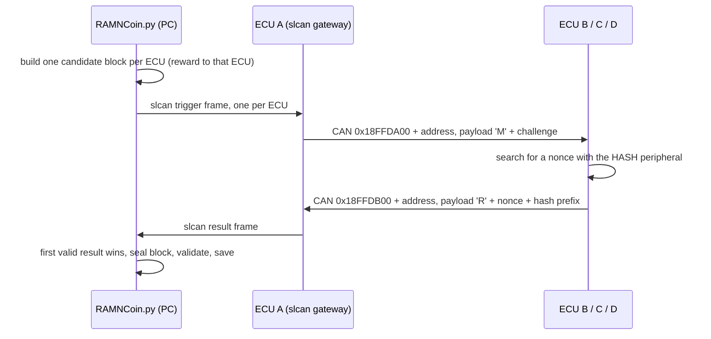

# RAMN Coin

RAMN Coin is an offline, educational toy blockchain. ECU B, C and D race to find a proof of work for a block, and a host script keeps the ledger. It has no monetary value, no network and no wallet. The whole ledger is one local JSON file.

There are three parts:

| Part | Where | Job |
|---|---|---|
| Firmware | [ramn_coin.c](../../firmware/RAMNV1/Core/Src/ramn_coin.c), [ramn_coin.h](../../firmware/RAMNV1/Core/Inc/ramn_coin.h) | Find a nonce for a challenge sent over CAN |
| Protocol | Extended CAN frames, relayed by ECU A as slcan | Trigger an ECU and return its result |
| Host | [RAMNCoin.py](RAMNCoin.py) | Build blocks, race the ECUs, validate and store the chain |

## How it works



1. For the next block the host builds one candidate per ECU. Each candidate pays the 50-coin reward to that ECU (`ecuB`, `ecuC` or `ecuD`) and includes the same pending transfers.
2. The host sends each ECU the challenge for its own candidate.
3. Each ECU searches for a nonce and replies over CAN.
4. The host recomputes the hash itself. The first valid result wins, and that candidate becomes the next block.

## CAN protocol

All frames are classic CAN with extended (29-bit) IDs. ECU addresses are B = `0x0B`, C = `0x0C`, D = `0x0D`. ECU A does not mine and never replies.

| Frame | ID | DLC | Payload |
|---|---|---|---|
| Trigger (host to ECU) | `0x18FFDA00` + address | 5 or more | `4D` (`'M'`), then the 32-bit challenge, big-endian |
| Result (ECU to host) | `0x18FFDB00` + address | 8 | `52` (`'R'`), then the nonce, 32-bit little-endian, then the first 3 bytes of the proof hash |

The proof hash is:

```
SHA-256( challenge (4 bytes, big-endian) || nonce (4 bytes, little-endian) )
```

A nonce is valid when the proof hash starts with two zero bytes (`00 00`). The result frame only carries the first 3 hash bytes, so the host recomputes the full hash to check it.

Example from a real board. The trigger for ECU B with challenge `DEADBEEF` is `18FFDA0B#4DDEADBEEF`. The reply was `18FFDB0B#52E2738DBA000069`, which decodes to nonce `0xBA8D73E2` and hash prefix `000069`.

Behaviour to know about:

- An ECU mines one challenge at a time. One more trigger can wait in its single-slot queue, and any further trigger is dropped without a reply. Wait for the result before sending the next one.
- The challenge can be any 32-bit value. The firmware does not know what a block is.
- Malformed triggers (wrong ID, remote frame, DLC under 5, wrong magic byte) are ignored.

### Talking to the ECUs without the host script

ECU A speaks the slcan serial protocol, so you can send the frames yourself. Make sure nothing else is using the serial port.

**Raw serial, no root needed:**

```bash
P=/dev/ttyACM0
stty -F $P 2000000 raw -echo -hupcl min 1 time 0
exec 3<>$P
(sleep 0.5; printf 'O\r' >&3; sleep 0.4; printf 'T18FFDA0B54DDEADBEEF\r' >&3) &
timeout 6 cat <&3 > /tmp/can.raw
printf 'C\r' >&3; exec 3>&-
tr '\r' '\n' < /tmp/can.raw | grep '^T18FFDB'
```

`O` opens the slcan channel and `C` closes it. A trigger is written as `T`, the 8-digit ID, the length (`5`), then the payload. The capture also holds the bus's normal traffic, so filter on `18FFDB`.

**SocketCAN with can-utils** (needs `sudo`):

```bash
sudo slcand -o -c /dev/ttyACM0 && sudo ip link set up can0
candump can0 | grep 18FFDB          # terminal 1
cansend can0 18FFDA0B#4DDEADBEEF    # terminal 2: trigger ECU B
sudo killall -w slcand              # release the port when done
```

## Firmware

The module only exists on ECU B, C and D. `ENABLE_RAMN_COIN` is defined for those targets in [ramn_config.h](../../firmware/RAMNV1/Core/Inc/ramn_config.h), and building the module for another target is a compile error.

- `RAMN_COIN_Init()` creates one static FreeRTOS task, `RAMN_Coin`, at low priority, so CAN, simulation and watchdog tasks keep running while it mines. It also creates a one-slot queue for challenges.
- `RAMN_COIN_ProcessRxCANMessage()` checks the frame and puts the challenge on the queue. If the single slot is already taken, the trigger is dropped.
- `Mining.` The task takes a challenge and picks a random start nonce from the hardware TRNG. It then tries consecutive nonces, hashing `challenge || nonce` with the STM32L5 HASH peripheral through the ST HAL (`HAL_HASHEx_SHA256_Start`, 8-bit data type so the first message byte is the most significant). It stops at the first hash with two leading zero bytes.
- `Reply.` The result is sent on the ECU's result ID. If the CAN transmit queue is busy the task retries up to 100 times, 10 ms apart.

### Tunables

All are `#define`d at the top of [ramn_coin.c](../../firmware/RAMNV1/Core/Src/ramn_coin.c):

| Name | Value | Meaning |
|---|---|---|
| `RAMN_COIN_TARGET_ZERO_BYTES` | 2 | Difficulty. The host also hardcodes this (`POW_ZERO_BYTES`), so change both together. |
| `RAMN_COIN_MAX_ATTEMPTS` | 1,000,000 | Give up after this many nonces and send the best result found. The host discards a result that does not meet the target. |
| `RAMN_COIN_HASH_TIMEOUT_MS` | 10 | HASH peripheral timeout per hash |
| `RAMN_COIN_STACK_WORDS` | 384 | Task stack size in words |
| `RAMN_COIN_SEND_RETRIES` | 100 | CAN transmit retries |

### Where it plugs into the firmware

| File | Change |
|---|---|
| [ramn_config.h](../../firmware/RAMNV1/Core/Inc/ramn_config.h) | `#define ENABLE_RAMN_COIN` in the ECU B, C and D sections |
| [ramn_customize.c](../../firmware/RAMNV1/Core/Src/ramn_customize.c) | `RAMN_CUSTOM_Init` calls `RAMN_COIN_Init`. `RAMN_CUSTOM_ProcessRxCANMessage` offers each frame to the coin module first and stops if it was consumed. |
| [ramn_canfd.c](../../firmware/RAMNV1/Core/Src/ramn_canfd.c) | The trigger ID is added to the hardware extended-ID filter list. ECU B, C and D only receive filtered IDs, so without this the trigger never arrives. The filter-count check now counts entries rather than bytes, since the hardware allows 8 extended filters. |
| [stm32l5xx_hal_conf.h](../../firmware/RAMNV1/Core/Inc/stm32l5xx_hal_conf.h) | `HAL_HASH_MODULE_ENABLED` |
| `Drivers/STM32L5xx_HAL_Driver/` | The HASH driver (`stm32l5xx_hal_hash.c`, `stm32l5xx_hal_hash_ex.c` and their headers), taken from ST's `stm32l5xx_hal_driver` |

New files under `Core/` are picked up by the Eclipse project automatically, so no project file needs editing.

### Build and flash

```bash
bash scripts/build/docker_BUILD_Clean_Debug.sh          # builds ECU A, B (two variants), C and D
bash scripts/STbootloader/linux/ProgramECU_BCD.sh       # flashes ECU B, C and D through ECU A
```

The images are written to `scripts/firmware/`. ECU A does not need reflashing.

## Host script

[RAMNCoin.py](RAMNCoin.py) needs Python 3 and, for ECU mining, `pyserial`. The ledger file defaults to `ramncoin.json` in the current directory; use `--ledger` to change it.

| Command | What it does |
|---|---|
| `init [--force]` | Create a ledger holding only the genesis block |
| `mine [--blocks N]` | Race ECU B, C and D for each block. Options: `--ecu B\|C\|D\|all`, `--port` (default `/dev/ttyACM0`), `--timeout` (default 30 s) |
| `mine --miner software [--name ACCOUNT]` | Mine on the PC instead, with no RAMN needed. The reward goes to `ACCOUNT` (default `software`). |
| `probe [--ecu ...] [--challenge HEX]` | Send a test trigger to each ECU and check its reply, without touching the ledger |
| `send FROM TO AMOUNT` | Queue a transfer for the next block |
| `balance [ACCOUNT]` | Show balances |
| `show` | Print every block and its transfers |
| `verify` | Re-validate the whole chain from the genesis block |

Typical use:

```bash
python RAMNCoin.py init
python RAMNCoin.py probe            # check that B, C and D answer
python RAMNCoin.py mine --blocks 3
python RAMNCoin.py send ecuB alice 10
python RAMNCoin.py mine
python RAMNCoin.py balance
python RAMNCoin.py verify
```

### How the host talks to the ECUs

`mine` opens the serial port at 2,000,000 baud (the speed is ignored by USB CDC), sends `O` to open the slcan channel, and writes one trigger line per ECU. It then reads slcan frames until one ECU returns a valid result, reads for one more second to discard late results, and sends `C`. A result is valid only if it is for that ECU's own challenge, the hash prefix matches, and the proof has two leading zero bytes. If nothing valid arrives within the timeout, `mine` fails with an error and the ledger is unchanged.

## Ledger and block format

The ledger file is `{"chain": [...], "mempool": [...]}`.

A block (the values here are illustrative):

```json
{
  "index": 3,
  "prev_hash": "<hash of block 2>",
  "merkle_root": "<root over the transactions>",
  "timestamp": 1791471344,
  "nonce": 3133111186,
  "transactions": [
    {"from": "COINBASE", "to": "ecuB", "amount": 50},
    {"from": "ecuB", "to": "alice", "amount": 10}
  ],
  "hash": "<block hash>"
}
```

The hashes are all SHA-256:

| Value | Definition |
|---|---|
| Transaction hash | `SHA256("from\|to\|amount")` |
| Merkle root | Pairwise hash of the transaction hashes up to one root. An odd level duplicates its last hash. No transactions gives 64 zeros. |
| Header digest | `SHA256("index\|prev_hash\|merkle_root\|timestamp")` |
| Challenge | The first 4 bytes of the header digest, sent to the ECU |
| Proof | `SHA256(challenge \|\| nonce)`, which must start with two zero bytes |
| Block hash | `SHA256(header digest \|\| nonce)`, with the nonce as 4 little-endian bytes |

The genesis block has index 0, an all-zero `prev_hash` and `merkle_root`, timestamp 0, nonce 0 and no transactions. Its hash is `1b74ff68254f3737aa70573be4b4d171f25e95c4c88708fa15932a49490d09b8`, and a test pins that value. Changing any hashing rule invalidates every existing ledger.

### Validation rules

`verify` re-checks the whole chain from block 0:

- Index and `prev_hash` link to the previous block, and the timestamp never goes backwards.
- The first transaction is a 50-coin reward from `COINBASE`.
- The Merkle root matches the transactions, the nonce is a 32-bit integer, the proof has two leading zero bytes, and the block hash matches.
- Every transfer is affordable in order. Account names are 1 to 32 characters from `A-Z a-z 0-9 _ -`, and `COINBASE` cannot be used.

`send` checks a transfer against the confirmed balances plus the transfers already queued, so you cannot queue an overspend. When mining, queued transfers that no longer apply are skipped, and at most 20 transfers go into one block (a mining limit that `verify` does not check).

## Limitations

Good next things to learn about:

- The proof only commits to 32 bits of the block header, so it is forgeable with about 2^32 work. A real chain hashes the whole header.
- The difficulty is fixed in the firmware and never adjusts.
- Transactions are not signed, so anyone can "spend" anyone's balance. Public-key signatures are the natural next step.
- The ECUs do not authenticate triggers or results on the CAN bus.
- Timestamps only have to be non-decreasing.
